# dot.
Trackpad + puntatore wireless per il Mac, in Safari su iPhone.

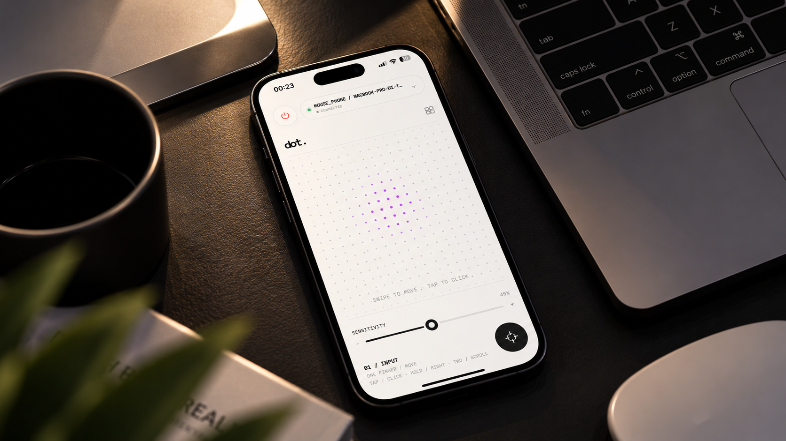

> **dot.** trasforma l'iPhone in trackpad + puntatore per il Mac: pad multi-touch,
> giroscopio per il puntatore, media e bookmark, senza app da installare.

## Setup

```bash
npm install
npm run certs     # genera CA locale + certificato server (una tantum)
npm start         # compila helper + icona e avvia il server
```

All'avvio:

```
Mac:     https://localhost:8443
join:    https://192.168.x.x:8443        <- QR / iPhone
iPhone:  https://<HostName>.local:8443   (mDNS / Bonjour)
CA:      http://192.168.x.x:8080/ca       (installazione certificato)
```

## Installazione una tantum sull'iPhone (IMPORTANTE)

iOS Safari **rifiuta le WebSocket `wss://` con certificati self-signed**, anche se
installati: la connessione si apre e si chiude subito. Per questo il server usa
una **CA locale** che firma il certificato del server: va resa fidata sul telefono
una sola volta.

1. Sul Mac avvia `npm start` (deve restare acceso).
2. Sull'iPhone, in **Safari**, apri `http://192.168.x.x:8080/ca` (l'IP che stampa
   il server) → tocca **INSTALLA IL PROFILO**.
3. Impostazioni → **Profilo scaricato** → Installa → passcode → Installa.
4. Impostazioni → Generali → Info → **Impostazioni attendibilità certificati** →
   attiva l'interruttore per **mouse_phone Local CA** → Continua.
5. Ora apri `https://192.168.x.x:8443` (o scansiona il QR): nessun avviso e la
   WebSocket resta connessa.

Alternativa senza endpoint HTTP: AirDrop di `certs/rootCA.pem` dal Mac all'iPhone.

### Se i WebSocket si disconnettono ancora
- Disattiva **iCloud Private Relay** per questa rete (Safari su iOS 26 ha
  regressioni note con WS + Private Relay).
- Assicurati di usare l'**IP esatto presente nel SAN** del certificato
  (visibile con `npm run certs`); se l'IP cambia, rigenera i certificati.

## Uso

| Pad · tap | Click sinistro |
| Pad · tieni premuto | Click destro |
| Pad · 2 dita | Scroll |
| Pad · tap 2 dita | Click destro |
| Pad · swipe 3 dita ←/→ | Cambia scrivania sul Mac |
| Scuoti l'iPhone | Alert di conferma → invia **⌘W** (chiude la tab del browser) |
| Trascina giù (fuori dal pad) | Pull-to-refresh della web app |
| ⏻ | Accende/spegne il puntatore |
| ⌄ | Apre il pannello (testo, media, opzioni) |
| CALIBRA | Riporta il puntatore al centro |
| CALIBRA · tieni premuto 3s | Mette in **pausa** il giroscopio; un tap lo riattiva e ricentra |

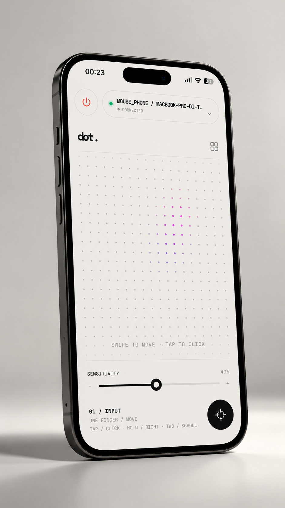

Dal divano, con l'Mac lontano dalla scrivania — il trackpad da un lato, Air Mouse Control dall'altro:

| Trackpad | Air Mouse Control |
|:---:|:---:|
| 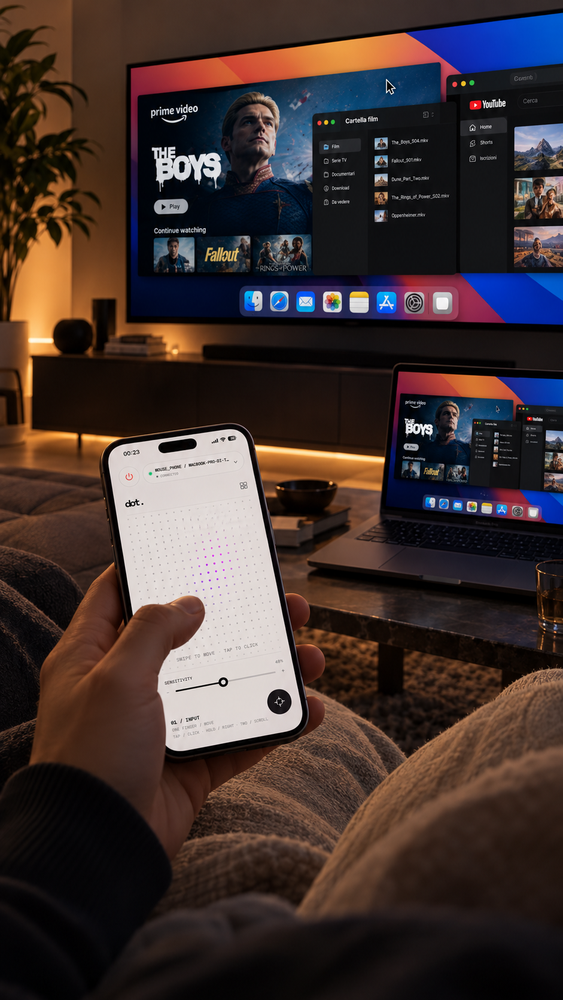 | 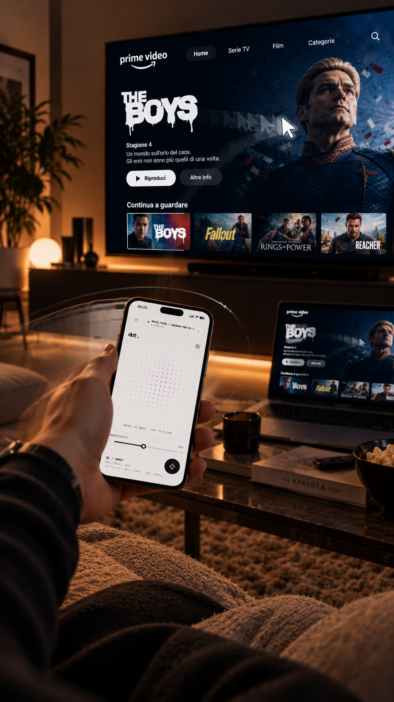 |

> Lo swipe a 3 dita invia **Ctrl+←/→** tramite **System Events**: la prima volta
> macOS può chiedere di consentire al terminale di controllare **System Events**
> (Impostazioni → Privacy e sicurezza → Automazione) e serve il permesso
> **Accessibilità** già richiesto per muovere il cursore.
>
> Lo **shake** usa l'accelerometro (`DeviceMotion`): al primo tocco la web app
> chiede il permesso "Movimento e orientamento". Scuotendo l'iPhone compare un
> alert **ANNULLA / CONFERMA**; confermando viene inviato **⌘W** al Mac.
>
> **Haptics**: il "tick" del Taptic Engine usa il controllo nativo
> `<input type="checkbox" switch>` (Safari 17.4+). Le label trasparenti sopra
> pad e CALIBRA danno il tick al tap; uno switch nascosto fa vibrare a comando su
> long-press, bordo schermo, media e chip (attivo fino a iOS ~26.4). Da iOS 26.5
> Apple ha bloccato il trigger via codice: lì il tick arriva solo al tap diretto.
>
> **Dark mode**: la web app segue la modalità del dispositivo
> (`prefers-color-scheme`). In dark il tema usa accenti **rossi** su sfondo
> nero/grigio.

## Cinema · bookmark · coda

La view **Cinema** è il lato "lounge" di dot.: dal divano lanci i link e li
controlli sul Mac, senza toccare la tastiera.

- **Bookmark** — griglia di scorciatoie (`/api/bookmarks`), riordinabili, con
  icona e URL: un tap e la pagina si apre sul Mac.
- **Cast** — incolla un link → **LANCIA** lo apre subito, **+ CODA** lo mette in
  coda (`/api/queue`).
- **Player** — coverflow dei titoli, volume e scrubbing, sezione
  **CONTINUE PLAYING** con riproduzione automatica della coda.

| Bookmark dal divano | Player per le serie | Coda sul desk |
|:---:|:---:|:---:|
| 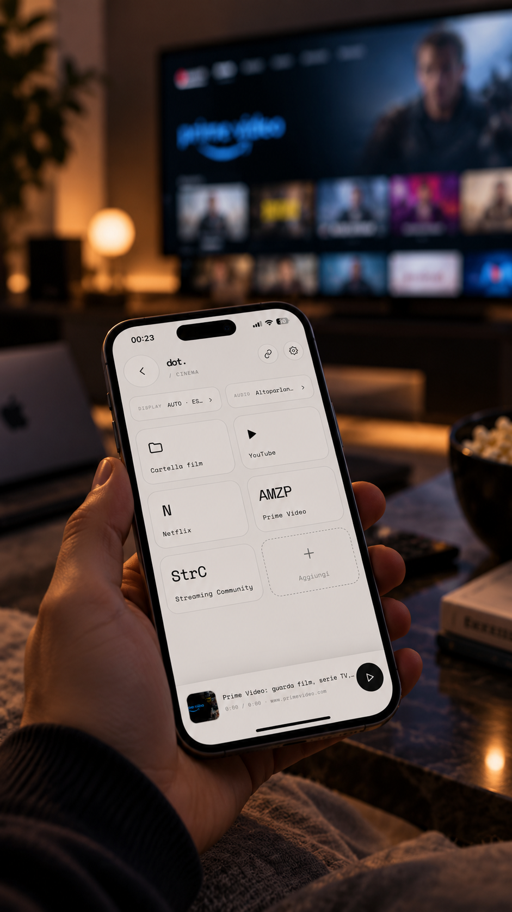 | 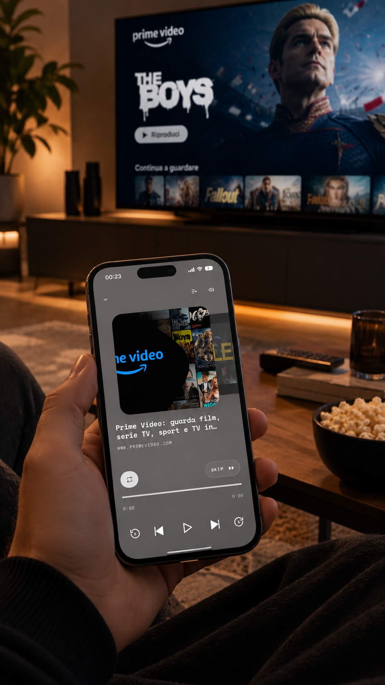 | 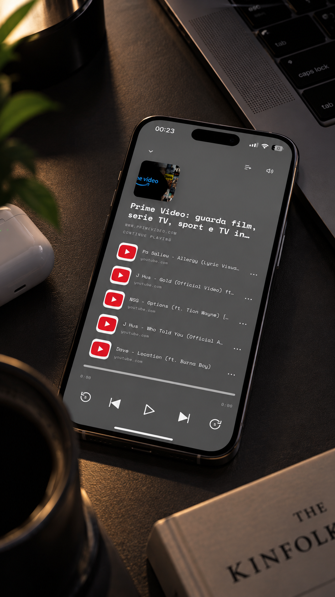 |

## Struttura

```
server.js                   server HTTPS + WebSocket + CA HTTP + QR
public/                     UI web (index/style/app + manifest + icona)
cursor/cursor_helper.swift  driver CGEvent (compilato con cursor/build.sh)
scripts/gen-certs.sh        CA locale + certificato server (PKI a 2 livelli)
scripts/gen-icon.swift      icona PWA 180×180
```

## Materiali

Mockup per l'App Store e slide informative:

| | |
|:---:|:---:|
| 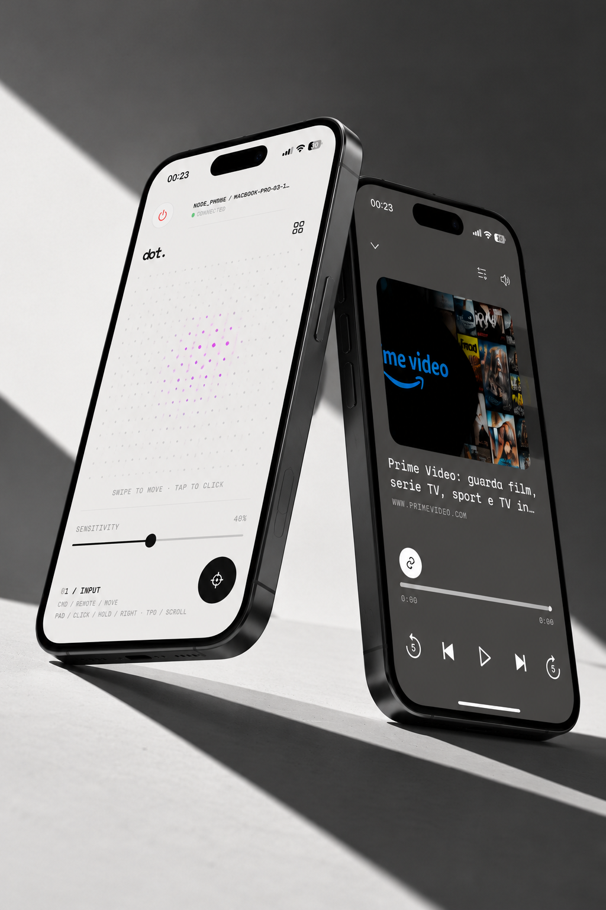 | 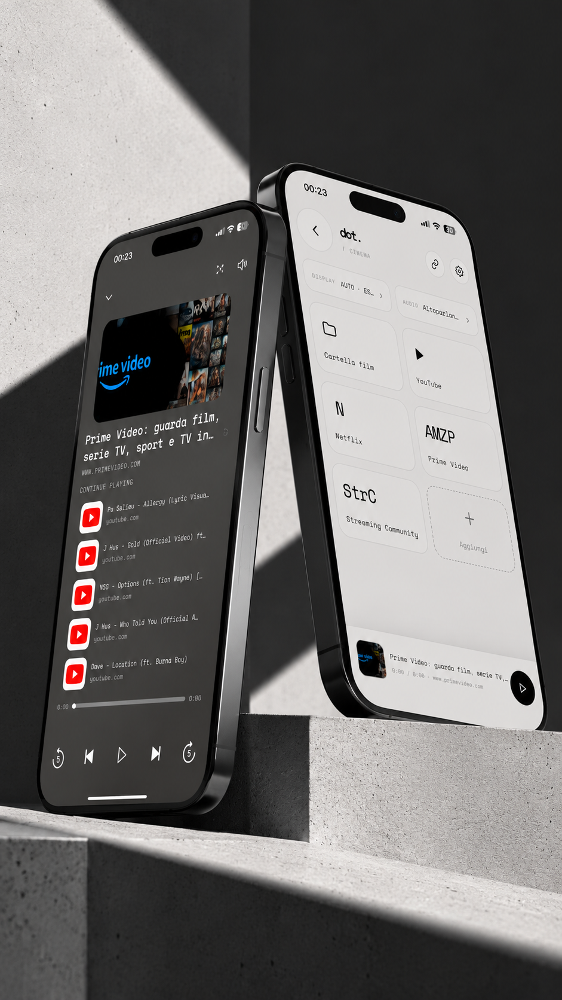 |
| 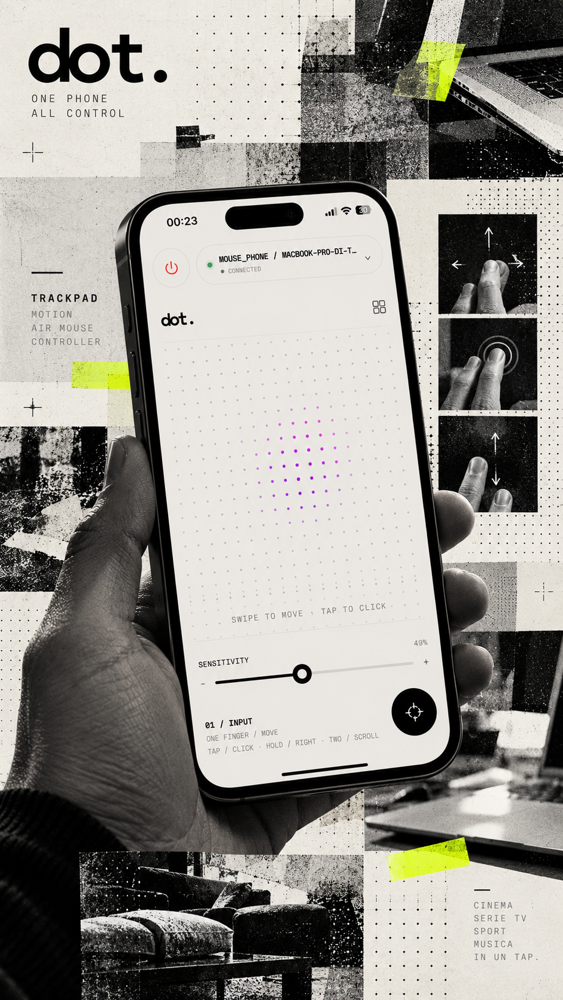 | 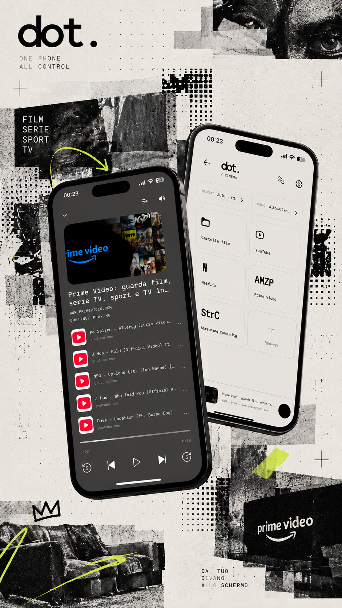 |
